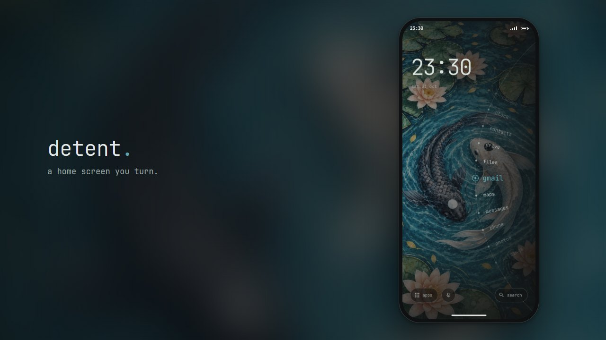
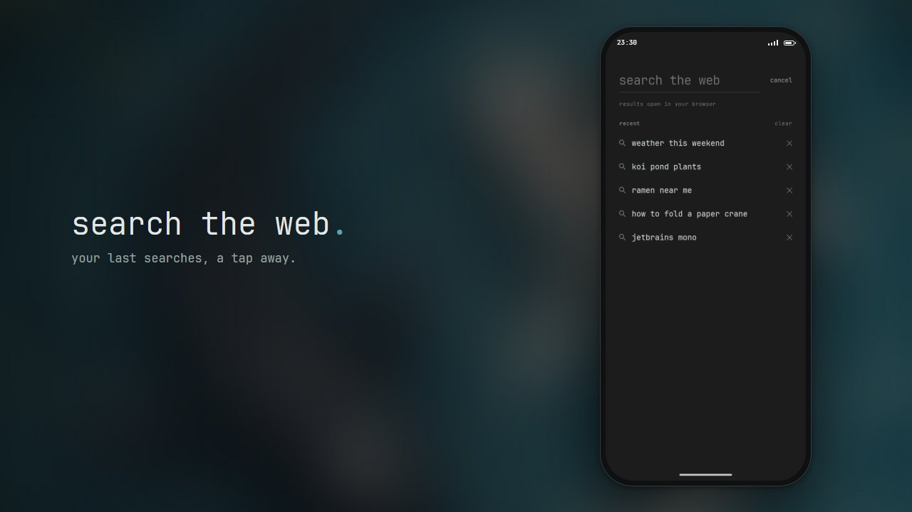
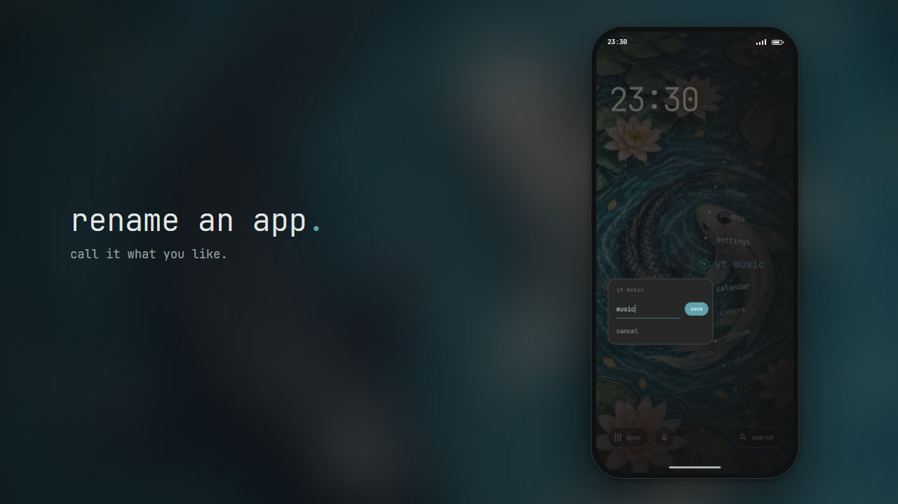
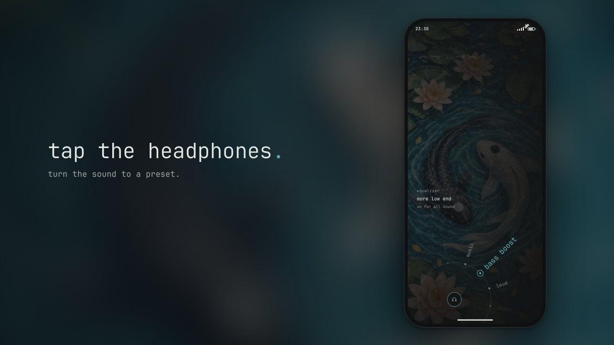
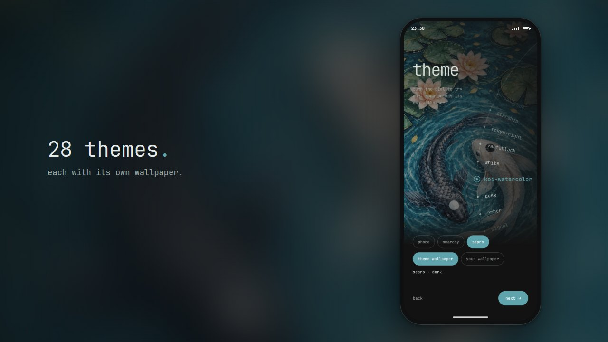

Like many people, I have a somewhat unhealthy relationship with my phone. Notifications go off far too often, usually for trivial things that don't need my attention, and my Android home screen kept every app just a tap away. Quickly looking something up turned into quickly checking the news, then quickly scrolling social media, and before I knew it, far more time had passed than I'd planned.

In [a recent podcast][doac], [Dr. Sahar Yousef][sahar-yousef] explained why: companies remove friction so that the unhealthy choice becomes the easiest one. Ready-made meals are easier than cooking, watching sports is easier than going to the gym, and having every app one tap away is an invitation to open them and stay there. Because we are wired to be drawn to bright, saturated colors, she had participants switch their phones to grayscale. Their phones became less appealing, and they used them about an hour less per day (note that other studies report a reduction in daily use by 20 - 30 minutes).

I tried it myself (careful, n=1) and it worked, but it also ruined the one thing I really enjoy using my phone for: sharing photos with my family. Grayscale adds friction *everywhere*. What I wanted was **friction in the right places**: make time-sink apps harder to open without removing them, because I do still need them now and then.

That's when, somewhat ironically, while mindlessly scrolling 𝕏, I stumbled on [Detent][detent-original], a minimalist Android launcher (the app that draws your home screen) by [bjarneo][bjarneo]. Instead of a grid of icons, your apps sit on a dial at the edge of the screen, which you have to turn to find and open the one you want. It takes just enough effort that you can't open an app on muscle memory alone. A few features I wanted were missing, but since it's open source, I could simply add them myself. There was just one small problem: I don't know Kotlin, the programming language it's written in. Luckily, Claude does.

Just want to try it? [Test it in your browser][detent-demo], or grab the [latest APK (Android installation file) from GitHub][detent-apk] and install it on your phone.

## Setting Up the Environment

Getting started in a new programming language can be a bit daunting. Fortunately, I had already been tinkering with Kotlin and Android apps a few weeks earlier, so Android Studio was installed, and opening the original project folder was enough to get going. After making sure the emulator (a virtual Android phone running on your computer) worked, I handed control over to Claude through its plugin. Because Claude has access to the emulator, it can run the app, tap through a few actions, take screenshots and check whether everything looks right.

As it turns out, you don't need to install anything, or even need a computer. Claude Code can run in a cloud environment, which you can control entirely from the Claude phone app! I'd describe what I wanted, have Claude make the changes in the cloud and build an APK, and then try it out on my phone right away. To stay on top of things, ask Claude to take screenshots of new features along the way, so you can check them before testing. If something feels off, simply go back to the same session and ask for a tweak. Finally, commit and merge the changes, and (when set up correctly) a [GitHub Action][github-actions-post] will build the APK for the new version automatically.

## Having Your Apps on a Dial

The dial does most of the heavy lifting here. None of the apps have icons, so getting to the right one takes a bit of effort. How far you need to turn the dial depends on where you start and which app you want, so you can't rely on muscle memory either. You can add as many apps as you like, but the more you add, the harder it becomes to find any of them. That turns out to be a nice side effect: every app you add makes the dial a little worse, so you have to decide which apps truly deserve a spot.

## Things I Changed

On the stock Android launcher, the feature I used most by far was the Google Search widget. Being able to quickly look something up is a must-have for me, and it's exactly the kind of phone use I don't want to add friction to. The version of Detent I started from didn't have search (newer releases do), so I added an option to replace the quick app button with a search button. My initial concern was that I'd miss Google's typeahead (the suggestions that pop up as you type), but after a few days I found that I didn't. What I did miss was a quick way to repeat an earlier search, so I had Claude add a list of recent searches to this screen. Searches go straight to Google, and the history is only stored locally on the phone.

One unexpected problem I quickly ran into involved my authenticator apps. Yes, plural. I have the official Authenticator app for two-factor authentication (2FA), but my university has its own app for this, with the exact same name: "Authenticator". On the stock launcher that isn't a problem, as both apps have clearly different icons. Without icons, however, you just see two identical names in a list. So I added an option to rename any app. Not only can I now tell my two authenticator apps apart, I can also shorten long app names (e.g. "OpenClaw Node" can simply be "OpenClaw"). It works the other way around too: nothing stops you from giving a time-sink app a name that makes you think twice before opening it.

The last thing I noticed was that the haptics option (the small vibrations you feel when tapping or turning the dial) didn't work on my device. It turns out I have touch feedback switched off system-wide, and Detent respects that setting, even when you explicitly enable haptics in the launcher. That is certainly a defensible choice, just not one that I agree with. If I switch something on in an app, I expect it to be on. And if a system setting prevents a feature from working, the toggle should at least be grayed out.

Since I prefer the option that gives me more control, which in this case means the launcher ignoring the system-wide setting, I had Claude figure out a way to do just that. This was the one change Claude couldn't check on its own (the emulator doesn't vibrate), so I built a test APK and tried it on my phone instead. That being said, I'm not a huge fan of haptic feedback (mostly because of the buzzing noise the vibration motor makes), so I switched it off again a few days later.

## A Built-in Equalizer

Detent had an option to switch on the mic and open any app by simply saying its name. As I'm not a huge fan of voice control, this is not a button I need. Instead of hiding it, I decided to replace it with a quick way to change the sound settings, since I use my phone a lot to listen to music and podcasts. Being able to switch between a voice setting for podcasts and different settings for different types of music seemed really useful. I do have other ways of doing this, but they have too much friction, so I never use them. This is the flip side of everything above: friction works both ways, and removing it from something you'd like to do more often is just as effective as adding it to things you'd like to do less.

After some back and forth about what to build and how, we landed on a second, smaller dial that appears around the equalizer button when you tap it. Turn it to pick one of seven presets: *off*, *voice*, *clear*, *music*, *bass boost*, *loud* and *night*. *Voice* cuts the low rumble and lifts the range where speech sits, which makes podcasts easier to follow on a noisy train. *Night* softens the bass and brings loud and quiet parts closer together, so you don't have to keep adjusting the volume (and the bass doesn't carry through the walls). While a preset is on, the headphones icon lights up in the theme's accent color, so you can see at a glance that the sound is being changed.

There is a catch, though. Android doesn't let apps change the phone's own equalizer, so Detent runs its own on top of the sound output. Some phones don't allow that, and then the equalizer only reaches music apps that announce their audio to equalizer apps. Many streaming apps, YouTube among them, don't do that. The dial tells you when this happens, so you aren't left wondering why nothing changed. On top of that, Android may close a launcher running in the background, which would switch the equalizer off with it. To prevent that, Detent shows a notification while a preset is on, with an `off` button. That's a small price to pay.

## My Own Theme

I could have made all of the features above by hand, but learning the tools and programming language, and then actually making the changes in my spare time, would have taken far too long. Creating images, however, is something I simply can't do myself, so here I relied on Gemini and ChatGPT to bring my vision to life. While I understand, and agree with, the concerns creatives have about AI, for me it is often the only way to get symbols, logos, backgrounds and the like, and the results are far better than anything I could create myself.

So I took a design I made for my desk mat a while ago, adapted it to fit a phone screen, added it to the project and matched the accent colors to it.

## Conclusion

Since switching to my custom launcher, the time I spend on Bluesky and 𝕏 has dropped drastically. Quickly (and sometimes almost compulsively) checking the prices of stocks I own has gone down to a healthier once a day or less. This has given me back time to spend on projects I find far more satisfying, and honestly, it has been a real mental boost. Because the hurdles are only in the right places, it never feels annoying. In the past (when I was struggling with repetitive strain injury, or RSI), I tried timers that automatically lock your computer every so often to force you to take a break. I also tried phone apps that limit how many times a day you can open an app. Those tend to block you at exactly the wrong moment, so you end up disabling or removing them right away, which makes none of them a sustainable solution. I've been using this launcher for weeks now and I'm still reaping the benefits. So if you share some of these bad phone habits, I'd strongly recommend giving it a spin, either my version or the original.

The source code for my version of Detent is available on [GitHub][detent-fork]. It is a fork of the [original Detent][detent-original] by [bjarneo][bjarneo].

## Further Reading

The one-hour reduction in phone use from Dr. Yousef's grayscale experiment hasn't been published yet, but smaller published studies point in the same direction:

  * Holte & Ferraro (2020) [True colors: Grayscale setting reduces screen time in college students][holte2020], *The Social Science Journal*. Switching to grayscale cut daily screen time by about 39 minutes.
  * Dekker & Baumgartner (2023) [Is life brighter when your phone is not?][dekker2023], *Mobile Media & Communication*. A pre-registered study where one week of grayscale reduced phone use by about 20 minutes a day, mostly in image-heavy apps.
  * Zimmermann & Sobolev (2023) [Digital Strategies for Screen Time Reduction: A Randomized Field Experiment][zimmermann2023], *Cyberpsychology, Behavior, and Social Networking*. Compares several strategies, with design friction such as grayscale reducing objectively measured screen time.

Deliberately adding friction works beyond grayscale too:

  * Grüning, Riedel & Lorenz-Spreen (2023) [Directing smartphone use through the self-nudge app one sec][gruning2023], *PNAS*. A short delay before opening an app made users abandon 36% of their attempts to open it, and over time they tried to open those apps less often.
  * Maas et al. (2012) [Do distant foods decrease intake? The effect of food accessibility on consumption][maas2012], *Psychology & Health*. Placing a bowl of M&M's farther away reduced how many were eaten.
  * Hollands et al. (2019) [Altering the availability or proximity of food, alcohol, and tobacco products to change their selection and consumption][hollands2019], *Cochrane Database of Systematic Reviews*. A systematic review: fewer options and less proximity mean less selection and consumption.

And examples where removing friction leads to behavior people would rather avoid:

  * Schaffner et al. (2025) [An Experimental Study of Netflix Use and the Effects of Autoplay on Watching Behaviors][schaffner2025], *Proceedings of the ACM on Human-Computer Interaction (CSCW)*. Disabling autoplay significantly reduced average daily watching time and session length.
  * Lukoff et al. (2021) [How the Design of YouTube Influences User Sense of Agency][lukoff2021], *CHI '21*. Autoplay and recommendations undermine users' sense of agency, while search and playlists support it.
  * Broekhoff & van der Cruijsen (2024) [Paying in a blink of an eye: It hurts less, but you spend more][broekhoff2024], *Journal of Economic Behavior & Organization*. Contactless payments feel the least painful, which is linked to overspending.

[doac]: https://podcasts.apple.com/us/podcast/phone-addiction-scientist-doing-this-gives-you-an/id1291423644?i=1000796433193
[sahar-yousef]: https://www.saharyousef.com/
[detent-original]: https://github.com/bjarneo/detent
[bjarneo]: https://github.com/bjarneo
[detent-fork]: https://github.com/sepro/detent
[detent-demo]: https://sepro.github.io/detent/
[detent-apk]: https://github.com/sepro/detent/releases/latest
[github-actions-post]: 
[holte2020]: https://doi.org/10.1080/03623319.2020.1737461
[dekker2023]: https://doi.org/10.1177/20501579231212062
[zimmermann2023]: https://doi.org/10.1089/cyber.2022.0027
[gruning2023]: https://doi.org/10.1073/pnas.2213114120
[maas2012]: https://doi.org/10.1080/08870446.2011.565341
[hollands2019]: https://doi.org/10.1002/14651858.CD012573.pub3
[schaffner2025]: https://doi.org/10.1145/3710928
[lukoff2021]: https://doi.org/10.1145/3411764.3445467
[prelec2001]: https://doi.org/10.1023/A:1008196717017
[broekhoff2024]: https://doi.org/10.1016/j.jebo.2024.03.017
