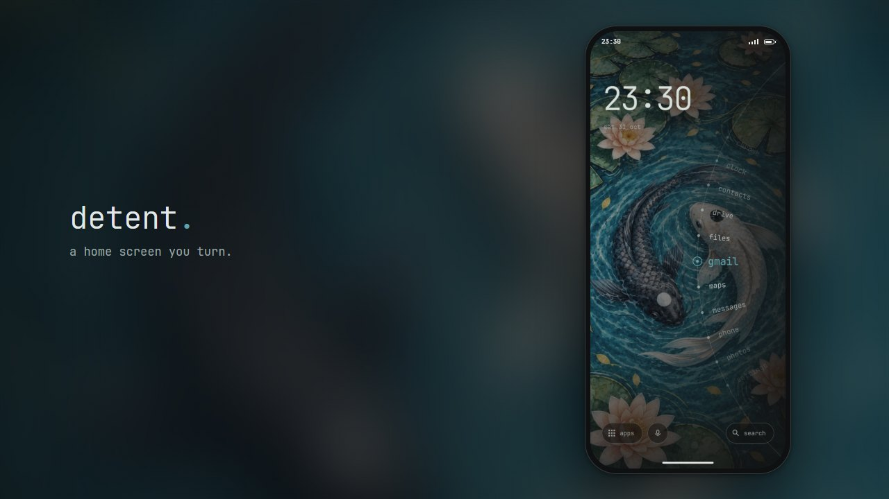
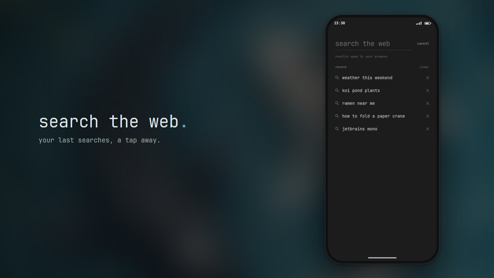
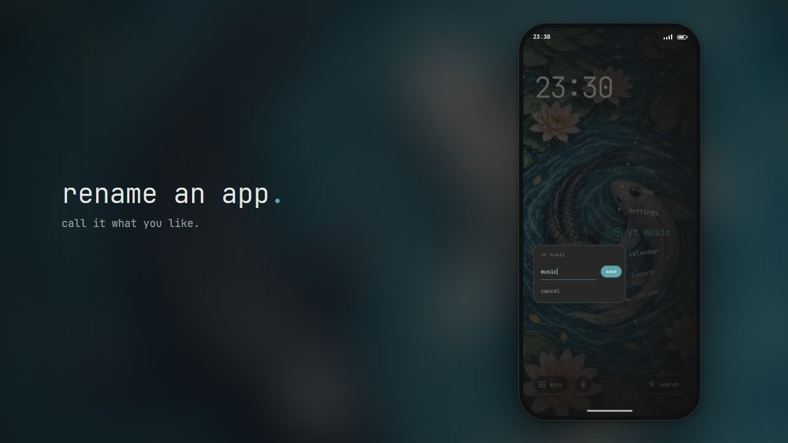
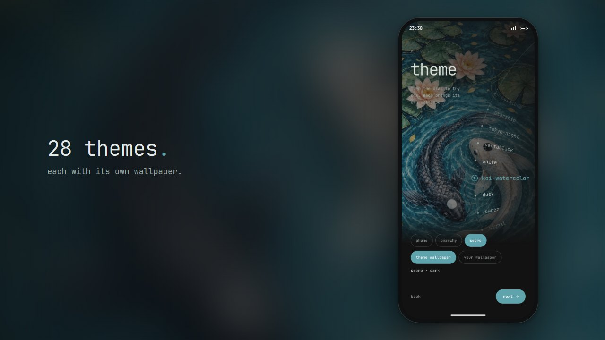

Zoals veel mensen heb ik een ietwat ongezonde relatie met mijn smartphone. Meldingen gaan veel te vaak af, meestal voor onbenullige dingen die mijn aandacht helemaal niet nodig hebben, en op mijn Android-startscherm stond elke app op amper één tik afstand. Even snel iets opzoeken werd even snel het nieuws checken, daarna even snel door sociale media scrollen, en voor ik het wist, was er veel meer tijd verstreken dan gepland.

In [een recente podcast][doac] legde [Dr. Sahar Yousef][sahar-yousef] uit waarom: bedrijven nemen frictie weg, zodat de ongezonde keuze de makkelijkste wordt. Kant-en-klare maaltijden zijn makkelijker dan koken, naar sport kijken is makkelijker dan naar de fitness gaan, en elke app op één tik afstand hebben is een uitnodiging om ze te openen en erin te blijven hangen. Omdat we van nature aangetrokken worden door felle, verzadigde kleuren, liet ze deelnemers hun smartphone op grijstinten zetten. Daardoor werd hun smartphone minder aantrekkelijk, en gebruikten ze hem ongeveer een uur minder per dag (let wel: andere studies rapporteren een daling van het dagelijkse gebruik met 20 - 30 minuten).

Ik probeerde het zelf (opgelet, n=1) en het werkte, maar het verpestte ook het enige waarvoor ik mijn smartphone echt graag gebruik: foto's delen met mijn familie. Grijstinten zorgen *overal* voor frictie. Wat ik wilde, was **frictie op de juiste plaatsen**: tijdverslindende apps moeilijker maken om te openen zonder ze te verwijderen, want af en toe heb ik ze toch nog nodig.

Toen stootte ik, enigszins ironisch, tijdens het gedachteloos scrollen op 𝕏 op [Detent][detent-original], een minimalistische Android-*launcher* (de app die je startscherm tekent) van [bjarneo][bjarneo]. In plaats van een raster met iconen staan je apps op een draaischijf aan de rand van het scherm, die je moet draaien om de app die je wilt te vinden en te openen. Dat kost net genoeg moeite om te verhinderen dat je een app louter op spiergeheugen opent. Een paar functies die ik wilde, ontbraken, maar omdat het *open source* is, kon ik die gewoon zelf toevoegen. Er was alleen één klein probleem: ik ken geen Kotlin, de programmeertaal waarin het geschreven is. Gelukkig kent Claude dat wel.

Wil je het gewoon eens proberen? [Test het in je browser][detent-demo], of download de [nieuwste APK (Android-installatiebestand) van GitHub][detent-apk] en installeer die op je smartphone.

## De omgeving opzetten

Beginnen in een nieuwe programmeertaal kan wat ontmoedigend zijn. Gelukkig was ik een paar weken eerder al aan het prutsen geweest met Kotlin en Android-apps, dus Android Studio stond al geïnstalleerd, en het volstond om de oorspronkelijke projectmap te openen om aan de slag te gaan. Nadat ik had gecontroleerd of de emulator (een virtuele Android-smartphone die op je computer draait) werkte, gaf ik via de plug-in de controle over aan Claude. Omdat Claude toegang heeft tot de emulator, kan het de app starten, door een paar acties tikken, schermafbeeldingen maken en controleren of alles er goed uitziet.

Wat blijkt: je hoeft niets te installeren, en je hebt zelfs geen computer nodig. Claude Code kan in een cloudomgeving draaien, die je volledig vanuit de Claude-app op je smartphone kunt bedienen! Ik beschreef wat ik wilde, liet Claude de wijzigingen in de cloud doorvoeren en een APK bouwen, en probeerde die meteen uit op mijn smartphone. Om het overzicht te bewaren, vraag je Claude het best om onderweg schermafbeeldingen van nieuwe functies te maken, zodat je die kunt nakijken voor je gaat testen. Voelt iets niet helemaal juist aan? Ga dan gewoon terug naar dezelfde sessie en vraag om een aanpassing. Tot slot doe je een *commit* en een *merge* van de wijzigingen, en (als alles correct is ingesteld) bouwt een [GitHub Action][github-actions-post] automatisch de APK voor de nieuwe versie.

## Je apps op een draaischijf

De draaischijf doet hier het meeste werk. Geen enkele app heeft een icoon, dus de juiste app vinden kost wat moeite. Hoe ver je de schijf moet draaien, hangt af van waar je begint en welke app je wilt, dus op je spiergeheugen kun je evenmin rekenen. Je kunt zoveel apps toevoegen als je wilt, maar hoe meer je er toevoegt, hoe moeilijker het wordt om er eentje terug te vinden. Dat blijkt een mooi neveneffect: elke app die je toevoegt, maakt de draaischijf een beetje slechter, dus moet je beslissen welke apps echt een plaatsje verdienen.

## Wat ik heb aangepast

Op de standaard-*launcher* van Android was de Google Search-*widget* veruit de functie die ik het meest gebruikte. Snel iets kunnen opzoeken is voor mij een must, en dat is precies het soort smartphonegebruik waaraan ik geen frictie wil toevoegen. De versie van Detent waarmee ik begon, had geen zoekfunctie (nieuwere versies wel), dus voegde ik een optie toe om de snelknop voor een app te vervangen door een zoekknop. Aanvankelijk vreesde ik dat ik de *typeahead* van Google (de suggesties die verschijnen terwijl je typt) zou missen, maar na een paar dagen merkte ik dat dat niet zo was. Wat ik wel miste, was een snelle manier om een eerdere zoekopdracht te herhalen, dus liet ik Claude een lijst met recente zoekopdrachten aan dit scherm toevoegen. Zoekopdrachten gaan rechtstreeks naar Google, en de geschiedenis wordt alleen lokaal op de smartphone bewaard.

Een onverwacht probleem waar ik al snel tegenaan liep, had te maken met mijn authenticator-apps. Ja, meervoud. Ik heb de officiële Authenticator-app voor tweefactorauthenticatie (2FA), maar mijn universiteit heeft daar een eigen app voor, met exact dezelfde naam: "Authenticator". Op de standaard-*launcher* is dat geen probleem, want beide apps hebben duidelijk verschillende iconen. Zonder iconen zie je echter gewoon twee identieke namen in een lijst. Dus voegde ik een optie toe om eender welke app een andere naam te geven. Niet alleen kan ik mijn twee authenticator-apps nu uit elkaar houden, ik kan ook lange appnamen inkorten ("OpenClaw Node" kan bijvoorbeeld gewoon "OpenClaw" worden). Het werkt ook andersom: niets houdt je tegen om een tijdverslindende app een naam te geven waardoor je twee keer nadenkt voor je hem opent.

Het laatste wat me opviel, was dat de optie voor haptische feedback (de kleine trillingen die je voelt wanneer je tikt of aan de draaischijf draait) niet werkte op mijn toestel. Blijkbaar heb ik aanraakfeedback systeembreed uitgeschakeld, en Detent respecteert die instelling, zelfs wanneer je haptische feedback in de *launcher* expliciet inschakelt. Dat is zeker een verdedigbare keuze, alleen niet een waar ik het mee eens ben. Als ik in een app iets inschakel, verwacht ik dat het ook aan staat. En als een systeeminstelling verhindert dat een functie werkt, zou de schakelaar op zijn minst grijs moeten worden weergegeven.

Omdat ik de voorkeur geef aan de optie die me meer controle geeft, wat in dit geval betekent dat de *launcher* de systeembrede instelling negeert, liet ik Claude uitzoeken hoe dat precies kon. Dit was de enige wijziging die Claude niet zelf kon controleren (de emulator trilt niet), dus bouwde ik een test-APK en probeerde ik die op mijn smartphone uit. Dat gezegd zijnde ben ik geen grote fan van haptische feedback (vooral door het zoemende geluid van de trilmotor), dus schakelde ik het een paar dagen later weer uit.

## Mijn eigen thema

Alle bovenstaande functies had ik met de hand kunnen maken, maar de tools en de programmeertaal leren en de wijzigingen dan ook nog eens in mijn vrije tijd doorvoeren, zou veel te lang geduurd hebben. Afbeeldingen maken kan ik daarentegen gewoonweg niet zelf, dus hier rekende ik op Gemini en ChatGPT om mijn visie tot leven te brengen. Hoewel ik de bezorgdheden van creatieve makers over AI begrijp, en deel, is het voor mij vaak de enige manier om aan symbolen, logo's, achtergronden en dergelijke te geraken, en de resultaten zijn veel beter dan alles wat ik zelf zou kunnen maken.

Dus nam ik een ontwerp dat ik een tijd geleden voor mijn bureaumat maakte, paste ik het aan zodat het op een smartphonescherm past, voegde ik het toe aan het project en stemde ik de accentkleuren erop af.

## Conclusie

Sinds ik overgestapt ben op mijn aangepaste *launcher*, is de tijd die ik op Bluesky en 𝕏 doorbreng drastisch gedaald. Snel (en soms bijna dwangmatig) de koersen checken van aandelen die ik bezit, is teruggebracht tot een gezondere keer per dag of minder. Dat heeft me tijd teruggegeven voor projecten die ik veel bevredigender vind, en eerlijk gezegd is het een echte mentale opsteker geweest. Omdat de drempels alleen op de juiste plaatsen liggen, voelt het nooit vervelend aan. Vroeger (toen ik worstelde met RSI, of *repetitive strain injury*) probeerde ik timers die je computer om de zoveel tijd automatisch vergrendelen om je te dwingen een pauze te nemen. Ik probeerde ook smartphone-apps die beperken hoe vaak per dag je een app kunt openen. Die blokkeren je meestal op precies het verkeerde moment, waardoor je ze meteen uitschakelt of verwijdert, en dus is geen enkele ervan een duurzame oplossing. Ik gebruik deze *launcher* nu al weken en pluk er nog steeds de vruchten van. Herken je jezelf in een paar van deze slechte smartphonegewoontes, dan raad ik je sterk aan om het eens te proberen, met mijn versie of met het origineel.

De broncode van mijn versie van Detent staat op [GitHub][detent-fork]. Het is een *fork* van de [originele Detent][detent-original] van [bjarneo][bjarneo].

## Verder lezen

De daling van het smartphonegebruik met een uur uit het grijstintenexperiment van Dr. Yousef is nog niet gepubliceerd, maar kleinere gepubliceerde studies wijzen in dezelfde richting:

  * Holte & Ferraro (2020) [True colors: Grayscale setting reduces screen time in college students][holte2020], *The Social Science Journal*. Overschakelen naar grijstinten verminderde de dagelijkse schermtijd met ongeveer 39 minuten.
  * Dekker & Baumgartner (2023) [Is life brighter when your phone is not?][dekker2023], *Mobile Media & Communication*. Een vooraf geregistreerde studie waarin een week grijstinten het smartphonegebruik met ongeveer 20 minuten per dag verminderde, vooral in apps met veel beeldmateriaal.
  * Zimmermann & Sobolev (2023) [Digital Strategies for Screen Time Reduction: A Randomized Field Experiment][zimmermann2023], *Cyberpsychology, Behavior, and Social Networking*. Vergelijkt verschillende strategieën, waarbij frictie in het ontwerp, zoals grijstinten, de objectief gemeten schermtijd verminderde.

Bewust frictie toevoegen werkt ook buiten grijstinten:

  * Grüning, Riedel & Lorenz-Spreen (2023) [Directing smartphone use through the self-nudge app one sec][gruning2023], *PNAS*. Een korte vertraging voor het openen van een app zorgde ervoor dat gebruikers 36% van hun pogingen om die app te openen afbraken, en na verloop van tijd probeerden ze die apps minder vaak te openen.
  * Maas et al. (2012) [Do distant foods decrease intake? The effect of food accessibility on consumption][maas2012], *Psychology & Health*. Een schaal M&M's verder weg zetten zorgde ervoor dat er minder van gegeten werd.
  * Hollands et al. (2019) [Altering the availability or proximity of food, alcohol, and tobacco products to change their selection and consumption][hollands2019], *Cochrane Database of Systematic Reviews*. Een systematische literatuurstudie: minder keuzemogelijkheden en minder nabijheid betekenen minder selectie en consumptie.

En voorbeelden waarbij het wegnemen van frictie leidt tot gedrag dat mensen liever zouden vermijden:

  * Schaffner et al. (2025) [An Experimental Study of Netflix Use and the Effects of Autoplay on Watching Behaviors][schaffner2025], *Proceedings of the ACM on Human-Computer Interaction (CSCW)*. Het uitschakelen van automatisch afspelen (*autoplay*) verminderde de gemiddelde dagelijkse kijktijd en de duur van kijksessies significant.
  * Lukoff et al. (2021) [How the Design of YouTube Influences User Sense of Agency][lukoff2021], *CHI '21*. *Autoplay* en aanbevelingen ondermijnen het gevoel van controle (*sense of agency*) van gebruikers, terwijl zoeken en afspeellijsten dat net ondersteunen.
  * Broekhoff & van der Cruijsen (2024) [Paying in a blink of an eye: It hurts less, but you spend more][broekhoff2024], *Journal of Economic Behavior & Organization*. Contactloos betalen voelt het minst pijnlijk aan, wat samenhangt met te veel uitgeven.

[doac]: https://podcasts.apple.com/us/podcast/phone-addiction-scientist-doing-this-gives-you-an/id1291423644?i=1000796433193
[sahar-yousef]: https://www.saharyousef.com/
[detent-original]: https://github.com/bjarneo/detent
[bjarneo]: https://github.com/bjarneo
[detent-fork]: https://github.com/sepro/detent
[detent-demo]: https://sepro.github.io/detent/
[detent-apk]: https://github.com/sepro/detent/releases/latest
[github-actions-post]: 
[holte2020]: https://doi.org/10.1080/03623319.2020.1737461
[dekker2023]: https://doi.org/10.1177/20501579231212062
[zimmermann2023]: https://doi.org/10.1089/cyber.2022.0027
[gruning2023]: https://doi.org/10.1073/pnas.2213114120
[maas2012]: https://doi.org/10.1080/08870446.2011.565341
[hollands2019]: https://doi.org/10.1002/14651858.CD012573.pub3
[schaffner2025]: https://doi.org/10.1145/3710928
[lukoff2021]: https://doi.org/10.1145/3411764.3445467
[prelec2001]: https://doi.org/10.1023/A:1008196717017
[broekhoff2024]: https://doi.org/10.1016/j.jebo.2024.03.017
